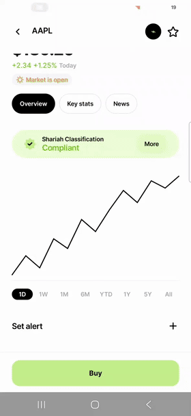

# Stock Buy tracer (Kotlin)

Native Android rebuild of a stock-buy flow, with a live trace of every hop.

[](docs/demo.mp4)

Screens: stock detail → buy form → confirm → order placed (live status).
Bottom panel and `adb logcat -s BuyTrace` show the path:

| Layer | Kotlin | Original |
|---|---|---|
| UI / VM | `BuyViewModel.openBuy / confirm` | `stock_trade_button.dart:314`, `advanced_buy_bloc.dart:242` |
| HTTP | `FakeBackend.createOrderV2` | `billing_client.g.dart` `POST /v2/orders` |
| GATEWAY / AUTH | `FakeBackend` | `apps/api/api.go:280`, `middleware/auth.go:133` |
| GRPC | `FakeBackend` | `services/billing_service.go:2396` `CreateOrderV2` |
| TX / FIX | `FakeBackend` | `db/sqlc/exec_tx.go:8`, `orders_tx.go`, `strategy_buy.go:102` |
| ASYNQ / WORKER | `FakeBackend.runWorkers` | `background/place_order.go`, `fix_service.go:60`, `orders.go:24` |

Fixes compared with the Flutter bloc: one submit at a time, the confirmed quantity is what is sent, and an `Idempotency-Key` per confirmation (the fake backend dedups on it).

Runs on an in-process fake backend. Tap the market pill to switch open/closed. Tap the round trace button in the app bar to see the hops.

```
./gradlew :app:testDebugUnitTest
./gradlew :app:installDebug
```
